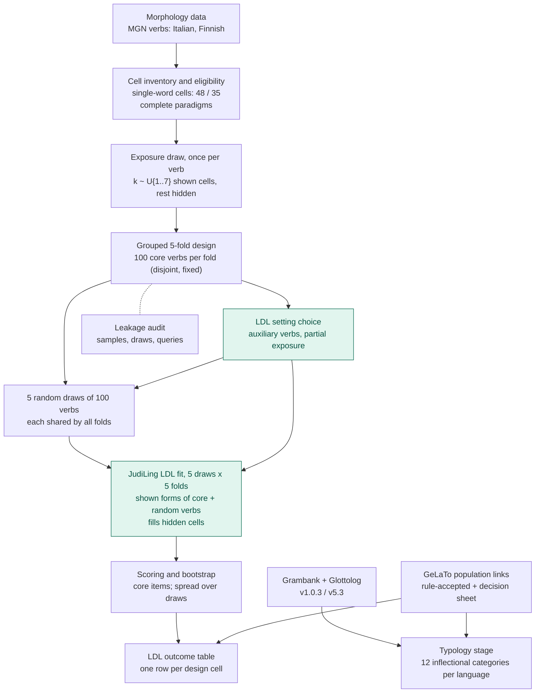

# Pipeline overview (`pcfp_v2`)

High-level map of the stages; details in [PROTOCOL.md](PROTOCOL.md) and [TYPOLOGY.md](TYPOLOGY.md),
results in [REPORT_pcfp_v2.md](REPORT_pcfp_v2.md) and
[analyses/admixture_links_2026_10_21/README.md](../analyses/admixture_links_2026_10_21/README.md).

Teal boxes are stages where models are fitted. The LDL outcome (inflecting languages
only) and the Grambank outcome (all GeLaTo-linked languages in Grambank) join on the
language-level Glottocode.

| Stage | What is fitted | Count in `pcfp_v2` |
|---|---|---|
| LDL setting choice | JudiLing on the shown forms of 200 auxiliary verbs, scored on the hidden cells of 100 of them; grid cue n-gram {2,3} × inflection SD {0.4,1,2,4} | 16 (8 settings × 2 languages) |
| Selection | None (5 independent random draws of 100 verbs; optional active selection under `cv.design: core_selected`) | 0 |
| LDL fit | JudiLing end-state model on 100 core + 100 extra verbs | 50 (5 draws × 5 folds × 2 languages) |
| Typology | None (category counts and population–language linkage only; Bayesian admixture models fitted outside the pipeline in `analyses/admixture_links_2026_10_21/`) | – |
